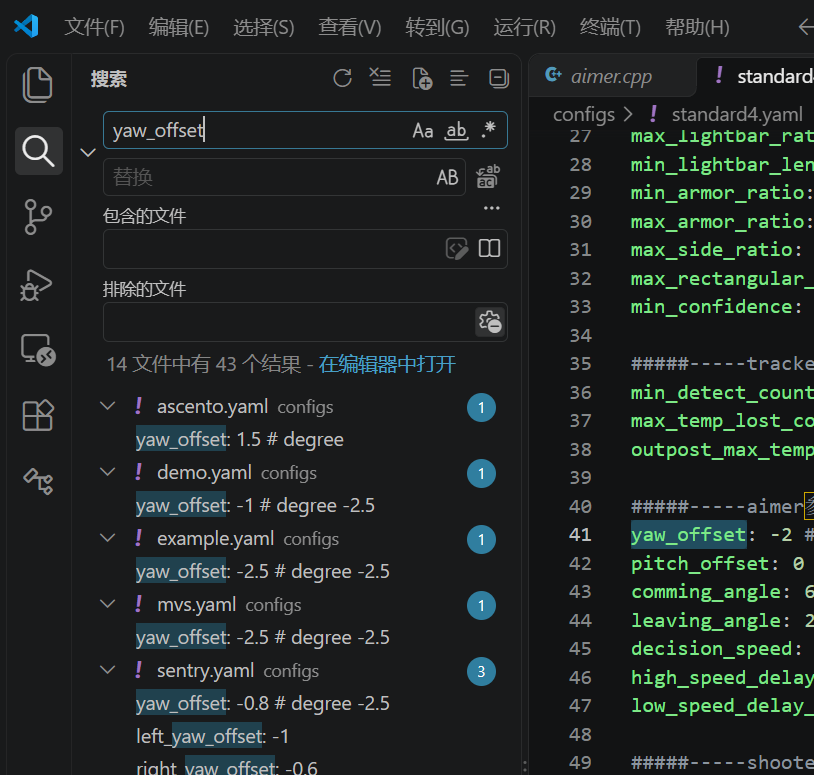

## Task 1
### (1) 基础任务
**你需要：**
&emsp;&emsp;从 Github 上将代码项目 `sp_vision_25` 克隆到你的虚拟机上，并将其编译，最后使用 video 文件夹下的**视频和文本文件**运行 `auto_aim_test`。
&emsp;&emsp;如果运行成功，程序应该会出现两个窗口，其图像大概如下：


**你需要提交：**
程序成功运行的截图，需要包含终端的界面和弹窗的画面。
### (2) 进阶任务（选做）
&emsp;&emsp;视频中，`detection` 窗口的绿色框表示**识别**到的装甲板，`reprojection` 窗口的绿色框表示经过卡尔曼滤波预测出目标的三维坐标后，再根据三维坐标**重新投影**出来的装甲板位置。
&emsp;&emsp;如果使用项目自带的参数运行，可以看到 `reprojection` 窗口中的绿色框与装甲板根本不重合，而且在上下浮动。这是因为这个视频是我们机器人拍摄的，但是使用的不是我们的参数。
&emsp;&emsp;video/demo.yaml 中填写的是我们机器人使用的一些参数，将其稍作修改并用于运行 `auto_aim_test`，即可使得 `reprojection` 窗口中的绿色框与装甲板大致重合。
&emsp;&emsp;不过其实，导致绿框严重偏移只是一行参数的问题。
 
**你需要：**
&emsp;&emsp;说明一下是**哪个参数**导致的绿框严重偏移？建议简单说明一下原因（~~当然如果你说你是试出来的也不是不行~~）
**你需要提交：**
说明原因的`.txt`或者其他格式的文本文件。

---
## Task2

### 一、程序相关问题
(1) 请阅读 src/standard.cpp 程序，这就是我们调用各种类以实现自瞄的主要程序。
**请回答：** 这个程序实现自瞄的流程是怎么样的？

(2) 请阅读 tasks/auto_aim/ 文件夹下的 solver.cpp 和 solver.hpp 程序。
**请回答：** 这两个程序中的有哪些成员方法其实是没有被调用的？

### 二、参数相关问题
&emsp;&emsp;问题将以 configs/standard4.yaml 参数文件为基础。
&emsp;&emsp;如果遇到不清楚的参数，我们通常需要去程序中找到它并阅读相关的调用它的代码。你可以使用VScode左边的搜索来尝试找到它被调用的位置。


**请回答以下问题：**
(1) 如果发现相机画面太暗了，调整哪些参数可以解决这个问题？
(2) 调整 `yaw_offset` 对自瞄有什么影响？如果发现击打位置出现一定偏移，只调整这个参数可能会有什么问题？
(3) 参数 `camera_name` 表示了我们相机的名字，为什么要有这个参数呢？

### 提交格式
请在 task2.txt 中（或者其他你认为合适的答案表现形式）按以下格式填写你的回答：
```txt 
一、
    (1) [你的回答...]
    (2) [你的回答...]
二、
    (1) [你的回答...]
    (2) [你的回答...]
    (3) [你的回答...]
```


---
## 打包建议

最后按作业要求打包，例如：

```text
视觉组_李华_final.zip
├── task1.png
├── task1.txt   <---如果有的话
└── task2.txt
```